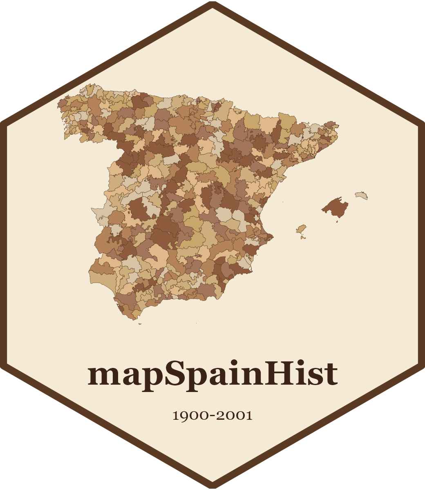

# mapSpainHist 

[English](README.md) · **Castellano** · [Català](README.ca.md)

**mapSpainHist** es un paquete de R con los **límites municipales de España para cada censo de
población entre 1900 y 2001** (1900, 1910, 1920, 1930, 1940, 1950, 1960, 1970, 1981, 1991 y 2001)
y con las **unidades territoriales superiores** construidas a partir de estos municipios:
provincias, partidos judiciales y circunscripciones electorales históricas. Incluye también los
**datos básicos de los censos** de cada municipio entre 1842 y 2011.

Todos los mapas proceden de una misma partición del territorio, de manera que **no tienen huecos
ni solapamientos** y se pueden agregar sin que queden vacíos entre unidades.

> **Aviso importante.** La forma de la mayor parte de los municipios históricos es una
> **reconstrucción aproximada**. Los mapas son especialmente útiles para **representar
> gráficamente datos municipales**, pero deben usarse **con cautela** cuando se tienen en cuenta
> variables geográficas como la **superficie** o las **distancias**. Véase la
> [metodología](https://pauvallprat.github.io/mapSpainHist/articles/es/metodologia.html).

## Instalación

```r
# Versión en desarrollo, desde GitHub
# install.packages("remotes")
remotes::install_github("pauvallprat/mapSpainHist")
```

Las geometrías se descargan de [Zenodo](https://doi.org/10.5281/zenodo.23663208) la primera vez
que se usan (unos 6,5 MB) y se guardan en la caché del ordenador; las veces siguientes se leen
directamente del disco.

## Uso

```r
library(mapSpainHist)

# Municipios del censo de 1930, con los datos del censo
m1930 <- esp_get_munic_hist(1930)

# Canarias junto a la península, como en el paquete `mapSpain`, con su recuadro
m1930 <- esp_get_munic_hist(1930, moveCAN = TRUE)
library(ggplot2)
ggplot(m1930) + geom_sf() + geom_sf(data = mapSpain::esp_get_can_box())

# Unidades superiores
esp_get_prov_hist(1930)   # provincias (disponible para todos los censos)
esp_get_pj_hist(1910)     # partidos judiciales (1900-1930)
esp_get_circ_hist(1920)   # distritos a Cortes de la Restauración
esp_get_circ_hist(1933)   # circunscripciones de la II República (también 1931 y 1936)

# Tablas
head(censos)    # datos de los censos de cada municipio, 1842-2011
head(unitats)   # a qué unidad superior pertenece cada municipio
```

| Función | Contenido | Años |
|---|---|---|
| `esp_get_munic_hist()` | Municipios | 1900, 1910, 1920, 1930, 1940, 1950, 1960, 1970, 1981, 1991, 2001 |
| `esp_get_prov_hist()` | Provincias | los mismos censos |
| `esp_get_pj_hist()` | Partidos judiciales | 1900, 1910, 1920, 1930 |
| `esp_get_circ_hist()` | Distritos a Cortes durante la Restauración (1920) y circunscripciones de la II República | 1920, 1931, 1933, 1936 |

## Documentación

- [Introducción](https://pauvallprat.github.io/mapSpainHist/articles/es/introduccion.html)
- [Unidades superiores y agregación de datos](https://pauvallprat.github.io/mapSpainHist/articles/es/unidades.html)
- [Guía de funciones y datos](https://pauvallprat.github.io/mapSpainHist/articles/es/funciones.html)
- [Metodología, fuentes y advertencias](https://pauvallprat.github.io/mapSpainHist/articles/es/metodologia.html)

## Problemas y sugerencias

Si detecta un error en los mapas o en los datos, o tiene alguna sugerencia, use el
[formulario de contacto](https://pauvallprat.github.io/mapSpainHist/articles/es/contacto.html), escriba a
[pau.vall@ub.edu](mailto:pau.vall@ub.edu) o
[abra una incidencia](https://github.com/pauvallprat/mapSpainHist/issues/new/choose) en GitHub.

## Cómo citarlo

Si utiliza el paquete y/o sus datos, cítelos. Una forma orientativa de referenciarlos es la siguiente:

```r
citation("mapSpainHist")
```

- Vall Prat, P. (2026). *Historical municipal boundaries of Spain, 1900-2001*
  [conjunto de datos]. Zenodo. https://doi.org/10.5281/zenodo.23663208

## Licencias

- **Código:** licencia [MIT](LICENSE.md).
- **Datos** (geometrías y tablas `censos` y `unitats`): licencia
  [Creative Commons Atribución 4.0 Internacional (CC BY 4.0)](https://creativecommons.org/licenses/by/4.0/deed.es).

Los límites municipales de referencia derivan del SIANE (© Instituto Geográfico Nacional,
CC BY 4.0), descargados a partir del año más antiguo disponible en el paquete `mapSpain`; los datos
de los censos, de los censos de población del INE; las variaciones municipales, del documento
elaborado por el Ministerio de Administraciones Públicas
[*Variaciones de los municipios de España desde 1842*](https://www.hacienda.gob.es/SGT/catalogo_sefp/100_variaciones-internet.pdf).
Véase el detalle en la metodología.
